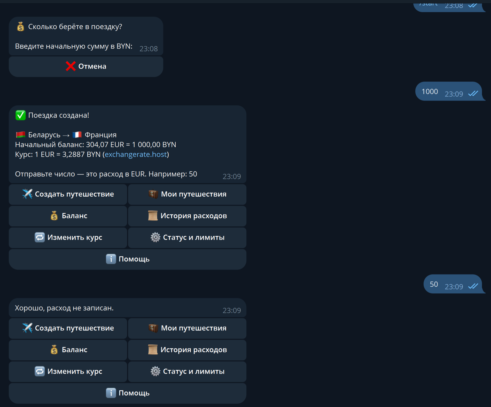
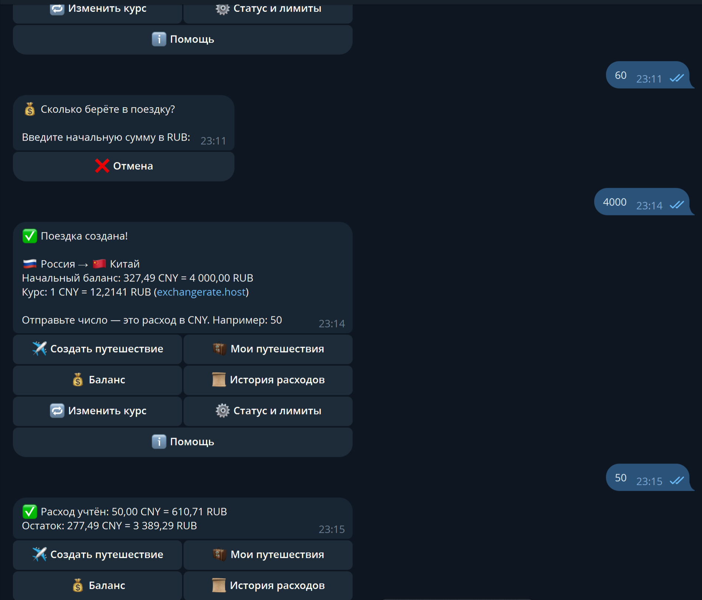
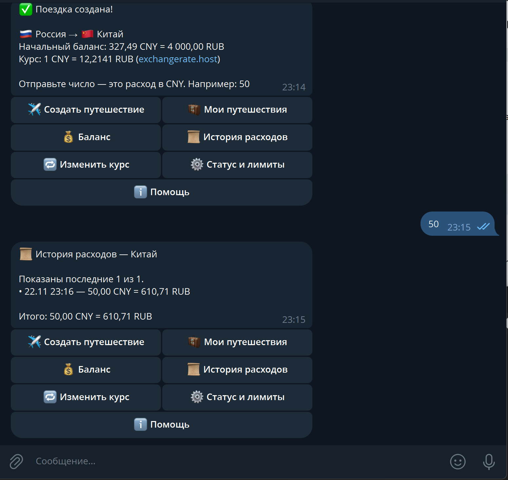
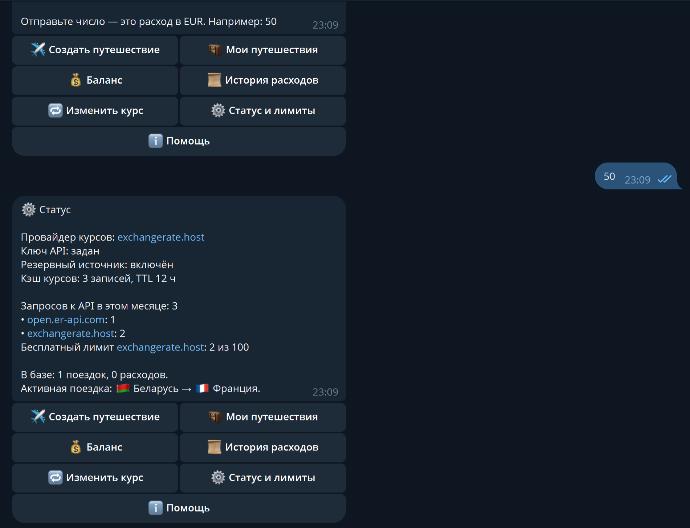
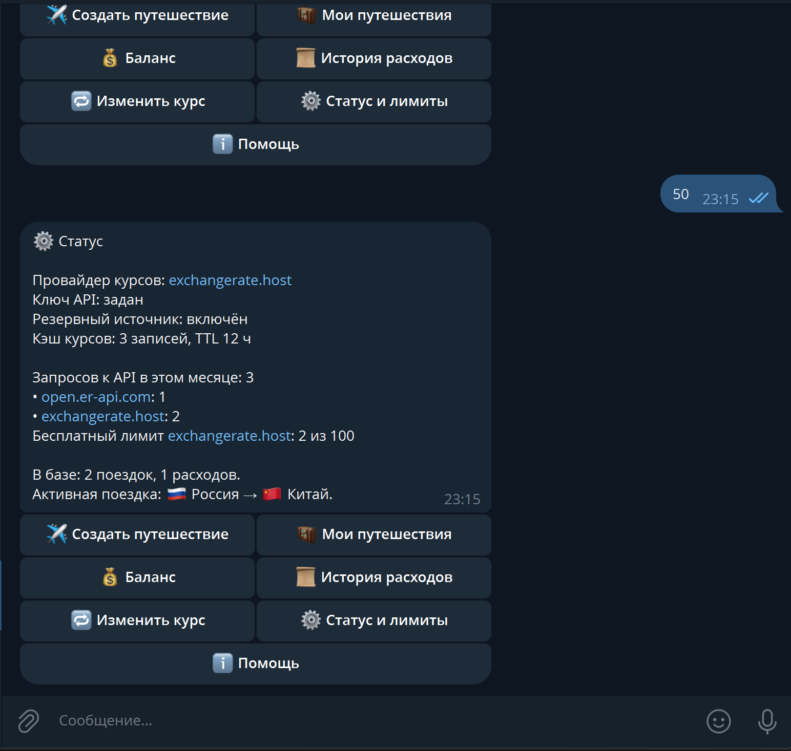

# currency-travel-bot — финансовый помощник для путешествий

Telegram-бот, который превращает конвертер валют в мини-кошелёк поездки:
создаёт путешествие с валютной парой, получает курс из API, хранит баланс
в двух валютах и ведёт историю расходов в SQLite.

Проект по теме **VPd05. Кейс 2: API-валюта**.

- Репозиторий: <https://github.com/IgorL0SEV/currency-travel-bot>
- Python 3.10+ (проверено на 3.12), Telegram-бот на `pyTelegramBotAPI`.

## Что умеет

- создаёт поездку: страна отправления → страна назначения, валюты определяются по стране;
- получает актуальный курс и показывает его перед созданием поездки;
- разрешает ввести свой курс (например, по курсу обменника);
- считает начальный баланс сразу в двух валютах;
- принимает расходы: любое сообщение с числом — трата в валюте страны пребывания;
- показывает остаток в двух валютах и историю расходов с датой и временем;
- хранит несколько поездок и переключается между ними;
- меняет курс поездки и пересчитывает домашний баланс;
- показывает, сколько запросов к API израсходовано за месяц;
- корректно обрабатывает ошибки: нет ключа, лимит, сеть, неверный ввод.

## Как это выглядит

```text
👤 /start
🤖 Привет! Я финансовый помощник для путешествий…
   [✈️ Создать путешествие] [🧳 Мои путешествия]
   [💰 Баланс]              [📜 История расходов]
   [🔁 Изменить курс]       [⚙️ Статус и лимиты]

👤 Создать путешествие → Россия → Китай
🤖 💱 Курс: 1 CNY = 12,2141 RUB
   Источник: exchangerate.host
   Обновлён: 22.11.2026 23:06 UTC
   Подходит?  [✅ Да] [✏️ Ввести вручную] [❌ Отмена]

👤 4000
🤖 ✅ Поездка создана!
   🇷🇺 Россия → 🇨🇳 Китай
   Начальный баланс: 327,49 CNY = 4 000,00 RUB
   Курс: 1 CNY = 12,2141 RUB (exchangerate.host)

👤 50
🤖 💸 50,00 CNY = 610,71 RUB
   Учесть как расход в поездке «Китай»?  [✅ Да] [❌ Нет]

👤 ✅ Да
🤖 ✅ Расход учтён: 50,00 CNY = 610,71 RUB
   Остаток: 277,49 CNY = 3 389,29 RUB
```

## Два источника курсов

Провайдер выбирается в `.env`:

| `CURRENCY_PROVIDER` | Ключ | Особенности |
|---|---|---|
| `exchangerate_host` | `CURRENCY_API_KEY` | основной сервис из задания, бесплатный тариф — 100 запросов в месяц |
| `open_er_api` | не нужен | резервный сервис без ключа, удобно для демонстрации |

Если основной сервис недоступен (нет ключа, исчерпан лимит, сеть), а
`CURRENCY_FALLBACK=1`, бот автоматически пробует второй и помечает ответ
как «резервный источник». Отключить это можно значением `CURRENCY_FALLBACK=0`.

Курс кэшируется в `data/rate_cache.json` на `RATE_CACHE_TTL_HOURS` часов
(по умолчанию 12), а при создании поездки сохраняется в базе. Поэтому
расходы не тратят лимит API.

## Быстрый старт

```powershell
git clone https://github.com/IgorL0SEV/currency-travel-bot.git
cd currency-travel-bot
python -m venv venv
.\venv\Scripts\Activate.ps1
pip install -r requirements.txt
Copy-Item .env.example .env
```

Заполните `.env`:

```ini
TELEGRAM_BOT_TOKEN=токен_из_@BotFather
CURRENCY_PROVIDER=exchangerate_host
CURRENCY_API_KEY=ключ_exchangerate.host
CURRENCY_FALLBACK=1
RATE_CACHE_TTL_HOURS=12
DATABASE_PATH=data/wallet.db
```

Запуск:

```powershell
python bot.py
```

Или в один клик (создаст venv и поставит зависимости):

```powershell
.\run.cmd
.\run.cmd demo
```

Токен бота создаётся в Telegram у `@BotFather`: `/newbot` → имя → username,
заканчивающийся на `bot` → скопировать токен в `.env`.

## Команды

| Команда | Действие |
|---|---|
| `/start` | приветствие и главное меню |
| `/newtrip` | создать путешествие |
| `/switch` | список поездок и переключение |
| `/balance` | остаток активной поездки |
| `/history` | последние расходы |
| `/setrate` | изменить курс поездки |
| `/status` | провайдер, ключ, кэш, расход лимита |
| `/help` | справка |
| `/cancel` | отменить текущий шаг |

Все основные действия доступны и кнопками inline-меню.

## Как считаются деньги

- Направление курса: **1 единица валюты поездки = N единиц домашней валюты**.
  Например, `1 CNY = 12,2549 RUB`.
- Начальная сумма вводится в домашней валюте. Валюта поездки:
  `домашняя сумма / курс`.
- Расход вводится в валюте поездки. Домашняя стоимость:
  `расход × курс`.
- Все расчёты идут через `Decimal` в одном модуле `money.py`.
  Деньги округляются до копеек (`ROUND_HALF_UP`), курс хранится с точностью
  до шести знаков.
- Домашний баланс уменьшается на стоимость каждого расхода, поэтому
  начальная сумма остаётся ровной, без «потерянной копейки» на округлении.
- При изменении курса домашний баланс пересчитывается от текущего баланса
  в валюте поездки. История уже записанных расходов не переписывается.

## Структура

```text
currency-travel-bot/
├── bot.py            # Telegram: команды, inline-меню, диалоги
├── current_api.py    # два провайдера курсов, кэш, счётчик запросов
├── database.py       # SQLite: пользователи, поездки, расходы
├── money.py          # Decimal, округление, разбор и формат сумм
├── countries.py      # страны, валюты, алиасы и коды
├── presentation.py   # тексты интерфейса (без Telegram)
├── config.py         # чтение .env
├── demo.py           # живая проверка без Telegram
├── run.cmd           # запуск в один клик
├── tests/            # 92 теста без сети
├── reference/        # справка по API курсов
├── screenshots/      # скриншоты рабочего бота (шапка обрезана)
├── requirements.txt
├── .env.example
└── README.md
```

Схема базы: `users` (активная поездка), `trips` (пара валют, курс, балансы),
`expenses` (сумма, домашняя стоимость, курс на момент траты, время).
Каждая поездка привязана к `user_id` Telegram — чужие данные не видны.

## Проверка

Тесты не ходят в сеть: HTTP-ответы подменяются, база создаётся во временной папке.

```powershell
.\venv\Scripts\python.exe -m unittest discover -s tests -v
```

Живая проверка без Telegram (реальный курс, временная база, два расхода):

```powershell
.\venv\Scripts\python.exe demo.py
.\venv\Scripts\python.exe demo.py --from USD --to EUR --amount 1000
```

Пример фактического запуска:

```text
✓ 1 CNY = 12,2141 RUB [exchangerate.host]
Начальный баланс: 327,49 CNY = 4 000,00 RUB
Остаток: 256,99 CNY = 3 138,90 RUB
Итого: 70,50 CNY = 861,10 RUB
```

## Живая проверка в Telegram

Скриншоты рабочего бота. Верхняя панель с именем аккаунта обрезана.

| Создание поездки | Расход и баланс |
|---|---|
|  |  |

| История расходов | Статус и лимит |
|---|---|
|  |  |

После двух поездок и одного расхода:



## Ограничения

- Бесплатный тариф exchangerate.host — 100 запросов в месяц. Кэш и хранение
  курса в поездке снижают расход, но при активном создании поездок лимит
  конечен; `/status` показывает остаток.
- Курс фиксируется при создании поездки. Это осознанное решение: баланс
  не «прыгает» от каждого обновления. Изменить курс можно вручную.
- В одной поездке одна валюта назначения. Несколько валют — в планах.
- Состояние незавершённого диалога хранится в памяти процесса. После
  перезапуска бота шаг придётся начать заново; созданные поездки и расходы
  сохраняются.
- Курс сервиса — ориентировочный рыночный, а не курс покупки/продажи
  конкретного банка.

## Безопасность

- `.env` и `venv/` исключены из git; в репозитории только `.env.example`
  с плейсхолдерами.
- Токен и ключ не выводятся в сообщения и логи. `/status` показывает лишь
  факт наличия ключа.
- Вводимые пользователем строки не подставляются в разметку Telegram
  (`parse_mode=None`), поэтому спецсимволы безопасны.

## Что дальше

- Категории расходов и лимиты бюджета.
- Несколько валют в одной поездке.
- Экспорт истории в CSV.
- Напоминание обновить курс перед поездкой.
